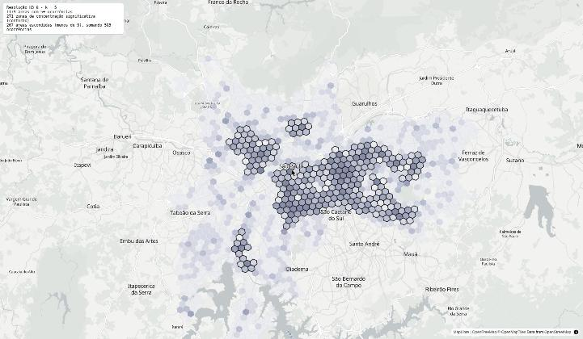
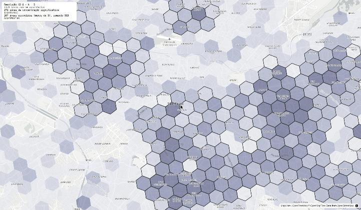

# Spike: hotspot zones (Getis-Ord Gi*)

**Question (D12):** how do we mark only *statistically significant* concentrations, at which H3 resolution, with which minimum count (k), and should it be precomputed in the pipeline or computed on demand in the BFF?

**Decision proposed:**

- H3 **resolution 8** (cells about 1 km across).
- A zone is a cell that is **significant by Gi\* after Benjamini–Hochberg FDR correction (q = 0.05)** *and* has **at least k = 5** occurrences itself.
- **No zones when the filter has fewer than 200 occurrences in total**; the UI says there are too few records to point out zones.
- **Precompute all 837 filter combinations in the pipeline** and store the zones with the monthly DuckDB release (D16). The BFF only reads them.

## Setup

- Data: allow-listed records from the storage spike, last 12 months (2025-10-01 to 2026-09-30), 32,588 occurrences with an H3 cell.
- `node/gi.ts`: Gi\* with binary queen-style weights (the cell and its 6 neighbours, `gridDisk(c, 1)`), study area = every cell with data plus a 2-ring margin (so empty neighbourhoods count as zeros), one-sided p-values for hot spots, FDR correction.
- `node/gi.test.ts`: finds a planted hot spot and nothing else in uniform noise, finds nothing in a flat grid, FDR is never looser than the raw 95% cut.
- `node/medir.ts`: runs resolutions 7, 8 and 9, a dense filter (everything) and a sparse one (motorcycle robbery, weekend, small hours: 140 occurrences), the effect of k, and all 837 combinations (vehicle × incident type × weekday/weekend × any subset of the 5 periods).

## Results

| | Res 7 (~2.5 km) | **Res 8 (~1 km)** | Res 9 (~350 m) |
|---|---|---|---|
| Cells with data | 275 | 1,446 | 7,112 |
| Zones, all filters (FDR) | 76 | 271 | 862 |
| **k = 5 hides** | 35 cells / 55 occ. (0.2%) | **267 cells / 583 occ. (1.8%)** | 4,764 cells / 10,328 occ. (32%) |
| Sparse filter (140 occ.), FDR only | 35 zones | 97 zones | **835 zones** |
| Sparse filter, FDR + k = 5 in the cell | 4 | **0** | 0 |
| All 837 combinations | 0.26 s | **0.49 s** | 1.5 s |
| Zone rows to store (all combinations) | 46k | 145k | 432k |

48 of the 837 combinations have fewer than 200 occurrences, 199 have 200–1,000, 590 have more than 1,000.

### What the numbers say

- **Gi\* hallucinates on sparse data.** With 140 occurrences, resolution 9 flagged 835 "significant" cells: when almost everything is zero, any 1 stands out. Requiring k occurrences in the cell itself removes this completely, and barely changes dense filters (272 → 271 at res 8).
- **Resolution 9 is too fine for k = 5.** It would hide a third of all occurrences. Resolution 8 hides 1.8% and still reads at street level when zoomed in. This also answers the open D6 (published spatial precision).
- **Computation is cheap.** All combinations take half a second at res 8, so precomputing in the pipeline costs nothing and keeps the statistics (FDR, k, minimum total, anomaly removal) in one auditable place. On-demand in the BFF would also be fast (~0.6 ms per combination), but would spread the rules across two services.

## How it looks (res 8, all filters, k = 5)

Faint anil fill = occurrence count (cells under 5 hidden). Dark outline = significant zone.

| City | Centre |
|---|---|
|  |  |

Page: `spikes/map-library/web/zonas-gi.html?gi=8` (needs `data/tmp/gi-8.json` from `node/medir.ts`).

## Product notes

- Zones sit over the densest, busiest parts of the city. The copy must keep saying "may reflect more vehicles circulating here" (D7, D13).
- Drawing one outer outline per zone (dissolving the cell mesh) would read better than outlining every cell; left for the design pass.
- The Praça João Mendes anomaly (D12) has to be removed in the pipeline **before** the allow-list, because the allow-listed records no longer have the address and police station needed to detect it.
- Period limits are still provisional (0–6, 6–12, 12–18, 18–24).

## Reproduce

```bash
cd spikes/storage/node && node gerar-base.ts
cd ../../hotspot/node
pnpm testar
node medir.ts
cd ../../map-library/web && pnpm build && pnpm preview   # open /zonas-gi.html?gi=8
```
