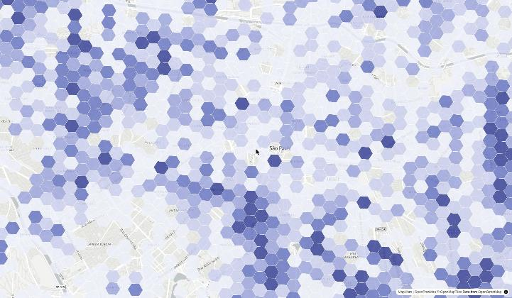
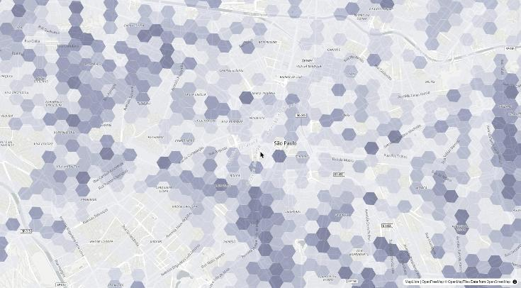

# Spike: map library (MapLibre or deck.gl)

**Question:** which library should render the incident zones (H3 hexagons) over the base map?

**Decision proposed:** MapLibre GL JS only, with zones as a GeoJSON `fill` layer. No deck.gl.

## Setup

- Data: 34,941 real 2025 vehicle robberies/thefts in São Paulo city with valid coordinates (39,005 unique vehicles after D2 dedupe and D4 classification), extracted locally from the SSP-SP spreadsheet with the D14 reader. Exact coordinates stay in `data/tmp/` (git-ignored) and are never committed.
- Aggregation: same code for both pages, H3 resolution 9 (7,222 cells), 5-step anil scale (design tokens), computed in the browser main thread (~40–60 ms).
- Base map: OpenFreeMap Positron vector tiles (no API key), same in both pages.
- Pages: `maplibre.html` (GeoJSON fill layer), `deckgl.html` (`H3HexagonLayer` through `@deck.gl/mapbox` over the same MapLibre map), `maplibre.html?sem-zonas` (base map only, baseline).
- Measurement: production build served by `vite preview`; `medir-fps.ts` drives Chrome through the DevTools protocol, opens each page in a dedicated foreground tab and records time to zones visible plus frames during a scripted 5 s fly-to (zoom 10.5 → 13.5 → 10.5). 3 runs per page, median reported.
- Two GPU scenarios: real GPU (Intel Lunar Lake iGPU, ANGLE/OpenGL ES) and software rendering (SwiftShader) as a proxy for weak phones.

## Results

| | MapLibre | deck.gl over MapLibre |
|---|---|---|
| JS shipped (gzip, excluding MapLibre worker) | **343 KB** | 580 KB (+69%) |
| Zones visible after load, real GPU | 566 ms | 466 ms |
| FPS during fly-to, real GPU | 60.0 (worst frame 22 ms) | 60.1 (worst frame 33 ms) |
| FPS during fly-to, **software GPU** | **13.7** (worst frame 183 ms) | **2.6** (worst frame ~1.1 s) |
| Works with MapLibre 6 | ✅ | ⚠️ only as a separate canvas on top; `interleaved: true` crashes (`Cannot read properties of undefined (reading 'height')` in the custom layer render) |
| Keyboard pan/zoom | built in | same (it is MapLibre underneath) |

Base map alone with software GPU: 17.3 FPS. So the zones cost MapLibre about 20% on a weak device, while deck.gl's extra WebGL canvas makes the map unusable there.

## Why MapLibre

- Same smoothness on a real GPU, far better on weak hardware: the project targets people on the street with phones, so the weak-device number matters most.
- 237 KB less JavaScript (gzip), which helps LCP on 4G (D9 risk).
- One rendering stack, one WebGL context, no version coupling between deck.gl and MapLibre.
- deck.gl's advantage (≈100 ms faster first paint of zones) is small and can be recovered by precomputing hexagon geometry in the BFF.

## Trade-offs and follow-ups

- deck.gl would make 3D extrusion, GPU aggregation and very large point sets easier. None is in the MVP; revisit only if the data grows by an order of magnitude.
- Feature-level keyboard navigation (move between hexagons with arrow keys, Enter opens the summary) is not provided by either library and must be built (accessibility cards).
- MapLibre 6 needs `setWorkerUrl` with the worker bundled as a separate file (see `src/comum.ts`).
- Real-phone check still to do in the performance phase; SwiftShader is only a proxy.

## Follow-up: colour scale (2026-11-19)

The first scale (saturated anil, 80% opacity, drawn above everything) hid streets and place names. Feedback: "the colours are too saturated, the map disappears a bit". The page now has `?suave`, which becomes the default for the product:

- Desaturated anil scale: `#E6E8F0`, `#C5CADC`, `#9AA2C2`, `#6B759F`, `#414A78` (top step still above 7:1 against white).
- 60% fill opacity and a faint outline, so blocks and streets show through.
- Zones inserted below the first symbol layer of the base map (`addLayer(layer, firstSymbolId)`), so street and place labels stay on top.

| Before | After |
|---|---|
|  |  |

Final colours are still up for the design refinement pass.

## Reproduce

```bash
pnpm --filter @mapa/spike-pipeline-runtime exec true
cd spikes/map-library/web
node extrair-pontos.ts
pnpm build && pnpm preview &
node medir-fps.ts
MODO=software node medir-fps.ts
```
